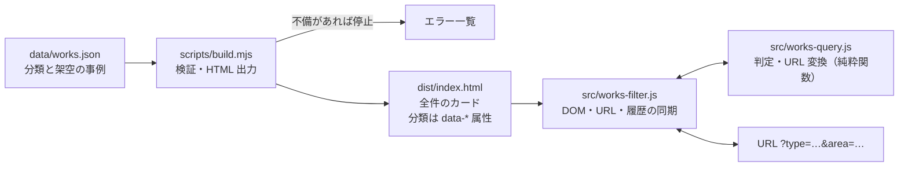

# aobotan-search-example

自主制作サイト「青牡丹工務店」で実装した施工事例の絞り込み機能から、検索条件の処理部分を公開用に切り出し、動作確認できる形に整えたサンプルです。サイト全体のソースコードや共通の開発基盤は含みません。

- 公開サイト：https://aobotan-koumuten.preview-dev.website/

> 掲載している事例はすべて、機能を説明するための架空のデータです。実在の施工実績ではありません。

## このサンプルで見せたいこと

- **検索条件とデータの分離**：事例データの検証と HTML の出力はビルド時に行い、ブラウザー側は出力済みのカードを出し分けるだけにしています。
- **条件の組み合わせ**：工事種別・エリア・建物種別の 3 分類で、同じ分類内は OR（いずれか）、分類間は AND（すべて）で判定します。
- **URL から状態を再現する設計**：条件をクエリパラメーターに保存し、再読み込み・URL 共有・ブラウザーの戻る／進むで条件と結果を復元します。壊れた URL でも表示を崩さず、正規化した URL に置き換えます。
- **テスト**：判定と URL 変換は DOM に依存しない純粋関数にして単体テストし、画面との同期（履歴操作を含む）は jsdom 上でテストしています。

## 担当範囲

元サイトのデザイン制作は担当していません。提供されたデザインをもとに、コーディングと施工事例検索機能の設計・実装・テストを担当しました。

このサンプルの画面は、元サイトのデザインではなく、動作確認用の簡素な UI に変更しています。

実装には AI コーディング支援（Claude Code）を使用しています。

## 動作環境と使い方

- 動作を確認した環境：Node.js 24.22.2（npm 11.19）と 22.23.4（npm 10.9）
- 推奨は Node.js 24 系の最新版です。[Volta](https://volta.sh/) を使っている場合は、`package.json` の指定で 24.22.2 に自動で切り替わります。
- `engines` には、2026年10月のセキュリティリリースで修正済みのバージョン以上（22.23.4 / 24.22.1 / 26.12.1）を指定しています。サポートが終了した Node.js 20 は対象外です。
- npm 11 の一部のバージョンでは、Sass の任意の依存（`@parcel/watcher`。`sass --watch` 用）のインストールスクリプトを実行しなかった旨の警告が出ます。このサンプルでは使わないため、そのままで動作します。

```sh
npm ci          # 依存パッケージのインストール（Sass、テスト用の Vitest と jsdom のみ）
npm test        # テストの実行
npm run build   # data/works.json を検証して dist/index.html を出力し、SCSS を CSS にコンパイル
npm start       # ビルドしてから http://localhost:4173/ で確認（ローカル確認用の簡易サーバー）
```

条件付きの URL を直接開く例：`http://localhost:4173/?type=renovation&area=hyogo`

## 構成とデータの流れ



| ファイル | 役割 | 由来 |
| --- | --- | --- |
| `src/works-query.js` | 条件 ⇔ URL の変換、OR／AND の判定 | 元サイトから抽出（処理は同じ。コメント内のパスのみ変更） |
| `src/works-filter.js` | チェックボックス・一覧・件数・選択中の条件・URL・履歴の同期 | 元サイトから抽出し簡略化（ページ送りを除去。イベント解除の戻り値を追加） |
| `src/main.js` | 初期化の呼び出し | 公開用に新規作成 |
| `src/styles/` | 動作確認用の簡素なスタイル（FLOCSS 構成の SCSS） | 公開用に新規作成（元サイトのデザイン・SCSS ではない） |
| `scripts/build.mjs` | データの検証、HTML 出力、SCSS のコンパイル | 公開用に新規作成（元サイトでは別の構成で同じ役割を担当） |
| `scripts/serve.mjs` | ローカル確認用の簡易サーバー | 公開用に新規作成 |
| `data/works.json` | 分類定義と架空の事例 10 件 | 公開用に新規作成 |
| `tests/works-query.test.js` | 判定と URL 変換のテスト | 元サイトのテストを移植し、6 件を追加 |
| `tests/works-filter.test.js` | 画面との同期、戻る／進むのテスト（jsdom） | 公開用に新規作成 |
| `tests/build.test.js` | データ検証・HTML 出力・クラス名と SCSS の対応のテスト | 公開用に新規作成 |

ディレクトリ構成とファイルの分け方は、このサンプルに合わせて用意したものです。元サイトや普段の制作環境の構成とは異なります。

読み始めるなら `src/works-query.js` → `tests/works-query.test.js` → `src/works-filter.js` の順がおすすめです。

## 検索の仕様

| パラメーター | 分類 | 値の例 |
| --- | --- | --- |
| `type` | 工事種別 | `new-build`, `renovation`, `interior`, `exterior` |
| `area` | エリア | `osaka-city`, `osaka-pref`, `hyogo`, `kyoto`, `nara` |
| `building` | 建物種別 | `house`, `apartment`, `office`, `factory`, `public` |

- 同じ分類内の複数選択はカンマ区切り（`?type=new-build,renovation`）で、OR 判定です。`?type=a&type=b` の形も読み取れます。
- 異なる分類は `&` でつなぎ、AND 判定です。選択のない分類は条件にしません。
- 1 つの事例が同じ分類の値を複数持てます（例：リフォーム・改修 ＋ 内装工事）。
- 未定義の値・空の値・重複・異常に長い値は、検索条件として扱いません。大文字や前後の空白は正規化します。
- `type` / `area` / `building` 以外のパラメーター（計測用の `utm_source` など）は、検索条件としては無視しますが、URL には元の順序のまま残します。
- 出力する URL は分類の順・定義順にそろえるため、同じ条件なら同じ URL になります。
- 条件を変えるたびに履歴を積み（`pushState`）、戻る／進むでは URL から状態を読み直します（履歴は積みません）。初回表示で正規化した URL は `replaceState` で置き換えます。

## 主な設計判断

- **ブラウザー側でデータを読まない**：全件のカードをビルド時に HTML として出力し、JS は `hidden` の付け外しだけを行います。JS が無効・読み込みに失敗した場合も全件の一覧として閲覧できます。
- **不正な URL はエラーにしない**：手入力や途中で切れた共有 URL を閲覧者は直せないため、無効な部分を黙って無視し、正規化した URL に置き換えます。
- **判定と DOM 操作を分ける**：OR／AND の判定と URL の変換は DOM に依存しない純粋関数にし、境界値や壊れた入力を単体テストで確認できるようにしています。
- **アクセシビリティ**：分類ごとに `fieldset` / `legend` でまとめ、件数は `role="status"` で通知します（条件なしで開いたときは読み上げません）。選択中の条件を解除してボタンが消えるときは、フォーカスを隣のボタンか先頭のチェックボックスへ移します。
- **CSP を緩めない**：インラインの script / style を使わず、`script-src 'self'` / `style-src 'self'` の CSP（meta で指定）のまま動作します。要素の生成は `innerHTML` を使わず `createElement` と `textContent` で行います。
- **初期化の失敗に備える**：初期化が終わるまで絞り込みは操作不可にしておき、失敗した場合は全件一覧に戻します。

## CSS の設計

[FLOCSS](https://github.com/hiloki/flocss) の考え方に沿って、SCSS を層ごとに分けています。どれもこのサンプルのために新しく書いたもので、値（色・余白など）もこのサンプル専用です。

| 層 | ディレクトリ | 内容 |
| --- | --- | --- |
| Foundation | `foundation/` | このサンプル用の変数と `rem()` 関数、要素の最小限の初期化 |
| Layout | `layout/` | ページの幅と余白（`.l-container`） |
| Component | `component/` | 再利用できる部品（`.c-button` / `.c-filter` / `.c-card`） |
| Project | `project/` | 施工事例一覧に固有の部分（`.p-works__*`） |
| Utility | `utility/` | 画面に出さずに読み上げさせる `.u-visually-hidden` |

- クラス名は BEM（`block__element--modifier`）で書き、見た目用は `l-` / `c-` / `p-` / `u-`、JS が使うのは `js-` だけに分けています（テストで、`js-` に見た目を指定していないことを確認しています）。
- 文字サイズと余白は `rem()` で rem に直しています。ブラウザーの文字サイズ設定に合わせて拡大されるようにするためです。
- 一覧の列数はブレークポイントを使わず、カードの最小幅（`grid-template-columns: repeat(auto-fill, minmax(...))`）で決めています。

## 元サイトとの違い

- 元サイトにある「施工事例の詳細ページ」「関連事例」「ページ送り」「写真」「構造化データ」は含めていません。
- 元サイトでは事例データを更新しやすい表形式のファイルで管理し、Astro で一覧・詳細ページを生成しています。このサンプルでは、その代わりに JSON と小さなビルドスクリプトを新しく書きました。
- 事例は 10 件の架空データに置き換えています。分類の名前は元サイトと同じですが、事例の名称・説明は新しく作成したものです。
- 画像・デザインカンプ・ロゴ・フォントは含めていません。

## 検証済みの内容

| 確認 | 方法 | 結果 |
| --- | --- | --- |
| 単体・画面同期テスト | `npm test`（Vitest 4.1.12 ＋ jsdom 27.4.0 ＋ Sass 1.105） | Node 24.22.2・22.23.4 のどちらでも 3 ファイル 50 件すべて成功 |
| クリーンな環境での再現 | `node_modules` を含めないコピーで `npm ci` → `npm test` → `npm run build` | 成功 |
| テストが不具合を検出できるか | AND 判定を OR に書き換える、`popstate` の処理を外す | それぞれ関連テストが失敗することを確認（確認後に元へ戻した） |
| 実ブラウザーでの動作 | Chromium（Playwright）で 1440px・375px 幅を確認 | 絞り込み、戻る／進む、再読み込み、不正な URL の正規化、該当なしの案内が動作。375px で横スクロールなし。CSP 違反・コンソールエラーなし |
| キーボード操作 | Tab でチェックボックスへ移動し Space で選択 | 動作 |
| JS 無効時 | Chromium で JavaScript を無効化 | 全 10 件の一覧と案内文を表示 |

## 未検証の事項

- Safari・Firefox、iOS・Android の実機では確認していません。
- VoiceOver・NVDA などのスクリーンリーダーでの実際の読み上げは確認していません（属性とフォーカス移動のみ確認）。
- Node.js 24.22.2・22.23.4 以外のバージョン（26 系を含む）での実行は確認していません。
- `scripts/serve.mjs` はローカル確認用です。本番配信用の設定（セキュリティヘッダー等）は含みません。

## 公開していない部分

元サイトの共通基盤（ビルド・納品・運用の仕組み）、ページテンプレート、お問い合わせフォームの送信処理、デザイン素材は、このリポジトリに含めていません。

## 著作権・ライセンス

<!-- 【公開前に確認】ライセンスの方針が決まったら、この節を確定してください -->
- このリポジトリには、オープンソースライセンスを設定していません。技術確認のための公開で、コードの再利用・再配布は許諾していません（著作権は作者に留保します）。
- なお、GitHub の利用規約により、公開リポジトリは GitHub 上で閲覧・fork できます。
- 依存パッケージ（Sass、Vitest、jsdom）は開発時のみ使うもので、このリポジトリには同梱していません。各パッケージのライセンスに従います。
- 画像・フォント、および依存パッケージ以外の外部ライブラリのコードは含まれていません。
